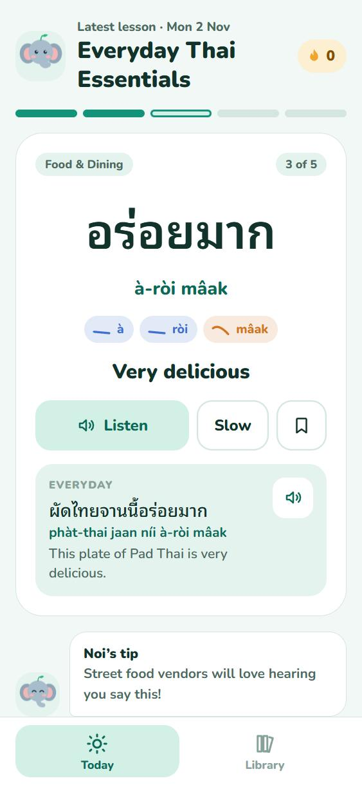
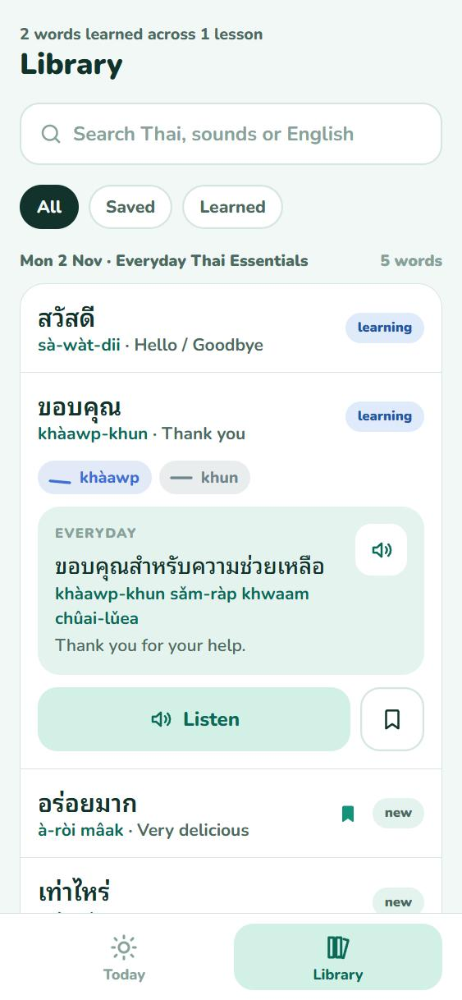

# 🐘 Nidnoi (นิดหน่อย) - Learn Thai Daily

> Five useful Thai words a day for people living in Thailand, delivered as an installable Progressive Web App (PWA) and generated by an automated AI content pipeline.

  

🔗 **[Try it live → nidnoi-app.vercel.app](https://nidnoi-app.vercel.app/)**

<p align="center">
  
  &nbsp;&nbsp;
  
</p>
<p align="center"><sub>Today's lesson (left) and the Library of past words (right)</sub></p>

---

## ✨ Features

- **Daily lessons:** 5 words a day around a real situation (Grab, 7-Eleven, the clinic…), with phonetics, per-syllable tone chips, example sentences and a tip from Noi the elephant.
- **Library:** every past lesson stays available. Search in Thai, phonetics or English, and save words to come back to.
- **Thai audio:** Web Speech API with normal and slow playback.
- **Streaks that mean something:** a day counts when you finish a lesson; missing a full day resets the streak.
- **Works offline and installs to the home screen** (service worker + web manifest).
- **Daily AI pipeline:** GitHub Actions asks Gemini for a new lesson every morning at 07:00 ICT, validates it, and commits it.

---

## 🗺️ Roadmap

- [x] **Phase 0 · Foundations:** React + TypeScript rebuild, new design, Today and Library screens, lesson history, streak fix, PWA, daily AI pipeline with retries and backup models
- [ ] **Phase 1 · Real learning app:** Review tab with spaced repetition and listening, reading and recall exercises; a Me tab with stats, a study calendar and settings (hide phonetics, ครับ/ค่ะ, speech speed)
- [ ] **Phase 2 · Thai foundations:** a Thai script and tone module, a leveled curriculum (A1 → A2) for the AI generator, daily reminders, final Noi artwork
- [ ] **Phase 3 · Accounts:** sign-in and progress sync across devices

---

## 🛠️ Tech stack

- **App:** React 19, TypeScript, Vite, Tailwind CSS v4
- **Storage:** IndexedDB via Dexie (progress stays on the device)
- **PWA:** vite-plugin-pwa (Workbox)
- **Tests:** Vitest
- **Content:** Node script + Google Gemini API, run by GitHub Actions
- **Hosting:** Vercel

---

## 🚀 Local development

Requires Node 24+.

```bash
git clone https://github.com/earthchawa/nidnoi-app.git
cd nidnoi-app
npm install
npm run dev          # start the dev server
npm test             # unit tests
npm run typecheck
npm run build        # production build in dist/
npm run check:data   # validate lesson files
```

---

## 📁 Project layout

```
public/data/index.json              list of lessons, newest first
public/data/lessons/YYYY-MM-DD.json one file per daily lesson
src/lib/lesson.ts                   lesson types + validation (shared with scripts)
src/lib/db.ts, progress.ts          learner progress in IndexedDB
src/screens/                        Today and Library screens
scripts/generate-daily.ts           daily AI lesson generator
scripts/check-data.ts               validates every lesson file and the index
scripts/retry.ts, gemini-models.ts  retries and backup models for busy Gemini APIs
design/prototype.html               clickable design prototype (all four planned tabs)
docs/                               README screenshots
```

---

## 🤖 Daily AI content workflow

`.github/workflows/daily-ai.yml` runs every day at 07:00 ICT. It:

1. Generates the lesson for today's date in Thailand, avoiding every word taught before.
2. Validates the structure (5 words, tones matching syllables, no repeats), and retries up to 3 times with the errors fed back to the model.
3. Commits `public/data/` to `main`, which Vercel then deploys.

**Setup:** add a repository secret named `GEMINI_API_KEY`. Optionally set a repository variable `GEMINI_MODEL` to change the model.

If Gemini is busy (HTTP 429/5xx), the script waits and retries, then moves to backup models: the newest stable Flash models your key can use, or the comma-separated list in the repository variable `GEMINI_FALLBACK_MODELS`.

To run it manually, open **Actions → Daily Thai Lesson Generator (Agentic AI) → Run workflow**. Tick *force* to regenerate a lesson that already exists.

To generate a lesson locally (PowerShell):

```powershell
$env:GEMINI_API_KEY="your-key"; npm run generate
```
