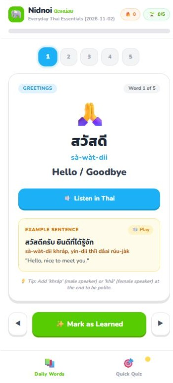

# 🐘 Nidnoi (นิดหน่อย) - Learn Thai Daily

> A modern, mobile-first EdTech Progressive Web App (PWA) designed to make learning Thai fun, bite-sized, and interactive—powered by an automated Agentic AI content pipeline.

  


🔗 **[Try it live → nidnoi-app.vercel.app](https://nidnoi-app.vercel.app/)**

<p align="center"></p>

---

## ✨ Features

- **Daily Micro-Lessons:** Fresh bite-sized Thai vocabulary, phonetic guides, English meanings, and practical example sentences every single day.
- **Native Thai Text-to-Speech:** Built-in audio playback using Web Speech API with adjusted speed (`0.85x`) tailored for language learners.
- **Interactive Quick Quiz:** Engaging multiple-choice quizzes to test daily comprehension with immediate feedback and celebratory animations.
- **Automated Agentic AI Pipeline:** Uses GitHub Actions and Gemini API to autonomously generate fresh, non-repeating daily lessons every morning without manual intervention.
- **Progress & Streak Tracking:** Persistent local storage that keeps track of daily streak counts and learned words.

---

## 🛠️ Tech Stack

- **Frontend:** HTML5, Tailwind CSS (via CDN), Vanilla JavaScript (Modular Architecture)
- **UI/UX Design:** Mobile-first, Duolingo-inspired playful 3D tactile interface
- **Automation / AI:** GitHub Actions (Cron Job) + Google Gemini API (`gemini-3.8-flash`)

---

## 🚀 Local Development

1. Clone the repository:
   ```bash
   git clone https://github.com/earthchawa/nidnoi-app.git
   cd nidnoi-app
   ```
2. Run locally using **Live Server** in VS Code or any static file server (e.g., `npx serve`).

---

## 🤖 Automated Daily AI Content Workflow

This project includes a built-in GitHub Action (`.github/workflows/daily-ai.yml`) that runs daily at 07:00 ICT. It queries the Gemini API to generate a brand new set of Thai words while cross-referencing past lessons to prevent duplication, then automatically commits and deploys the update.

To run it manually:
1. Go to your repository's **Actions** tab on GitHub.
2. Select **Daily Thai Lesson Generator (Agentic AI)**.
3. Click **Run workflow**.